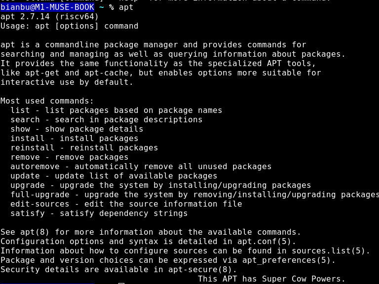

# 应用及软件管理

## 常用应用简介

按 `Super` 键打开活动概览，输入应用名称进行搜索，也可以点击 **显示应用程序** 浏览应用列表。以下是常见应用：

| 应用名称 | 软件包名 | 简要说明 |
| --- | --- | --- |
| 文件（Nautilus） | `nautilus` | 浏览文件和目录，访问可移动介质 |
| 文本编辑器（GNOME Text Editor） | `gnome-text-editor` | 打开和编辑纯文本文件 |
| 网页（GNOME Web） | `epiphany-browser` | 浏览网页，管理书签和浏览历史 |
| 文档查看器（Evince） | `evince` | 阅读 PDF 等文档 |
| 图像查看器（Loupe） | `loupe` | 浏览、缩放和旋转图片 |
| 视频播放器（mpv） | `mpv` | 播放本地视频和音频文件 |
| 相机（Snapshot） | `gnome-snapshot` | 使用摄像头拍照和录制视频 |
| 音乐（GNOME Music） | `gnome-music` | 浏览和播放本地音乐库 |
| 文档扫描仪（Simple Scan） | `simple-scan` | 扫描纸质文档并保存为 PDF 或图片 |
| 归档管理器（File Roller） | `file-roller` | 创建、打开和解压归档文件 |
| 计算器（GNOME Calculator） | `gnome-calculator` | 执行日常和科学计算 |
| 日历（GNOME Calendar） | `gnome-calendar` | 查看日程并创建事件 |
| 时钟（GNOME Clocks） | `gnome-clocks` | 查看世界时钟，使用闹钟、秒表和计时器 |
| 字体（GNOME Fonts） | `gnome-font-viewer` | 预览和安装字体 |
| 字符（GNOME Characters） | `gnome-characters` | 查找并复制特殊字符和表情符号 |
| 终端（GNOME Terminal） | `gnome-terminal` | 在带标签页的终端窗口中运行命令 |
| 控制台（GNOME Console） | `gnome-console` | 在简洁的终端界面中运行命令 |
| 磁盘（GNOME Disks） | `gnome-disk-utility` | 查看存储设备及分区，挂载或格式化介质 |
| 磁盘使用分析器（Baobab） | `baobab` | 分析目录和磁盘的空间占用 |
| 系统监视器（GNOME System Monitor） | `gnome-system-monitor` | 查看进程、CPU、内存和网络使用情况 |
| 日志（GNOME Logs） | `gnome-logs` | 浏览系统日志以排查问题 |
| 软件（GNOME Software） | `gnome-software` | 浏览和管理可用的图形应用 |
| LibreOffice Writer | `libreoffice-writer` | 编辑和排版文档 |
| LibreOffice Calc | `libreoffice-calc` | 编辑电子表格并处理数据 |
| LibreOffice Impress | `libreoffice-impress` | 制作和放映演示文稿 |

如果系统已安装 GNOME **软件** 应用，可在应用列表中搜索 **软件**，通过图形界面浏览和安装可用应用。如果没有这个入口，请使用 APT。

## 软件包管理器：APT

`APT`（Advanced Package Tool）是本系统的默认软件包管理器，用于管理 Debian 及其衍生发行版的软件包。`APT` 主要提供以下功能：

- **安装软件**：从官方软件源获取并安装所需软件包。
- **更新系统**：同步索引并升级已安装的软件包。
- **卸载软件**：移除不需要的软件包及其不再使用的依赖。
- **依赖管理**：自动解析并处理软件包之间的依赖关系，避免冲突。

`APT` 工具的帮助信息如下图所示，`apt` 命令详情请参考 Debian 13 的 [官方手册页](https://manpages.debian.org/trixie/apt/apt.8.en.html)。

